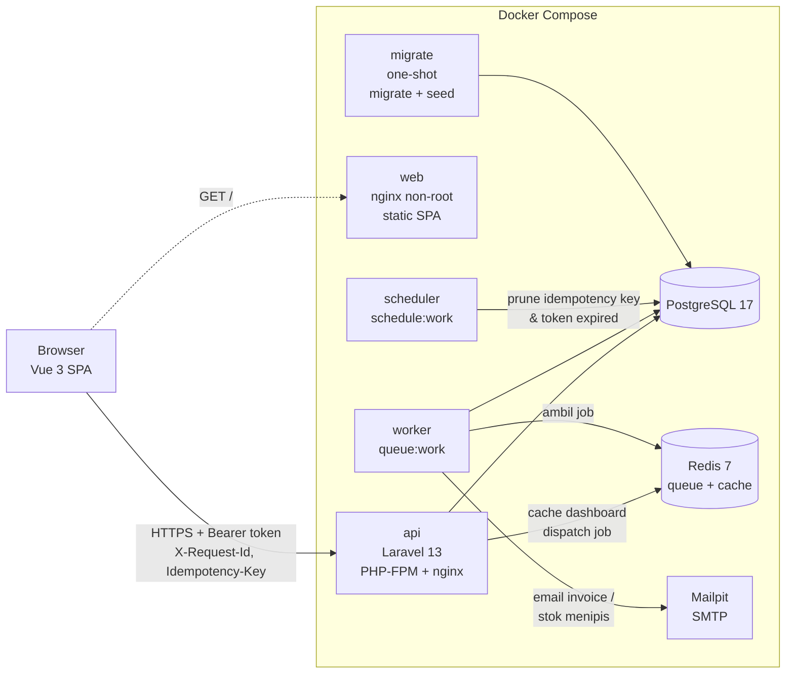
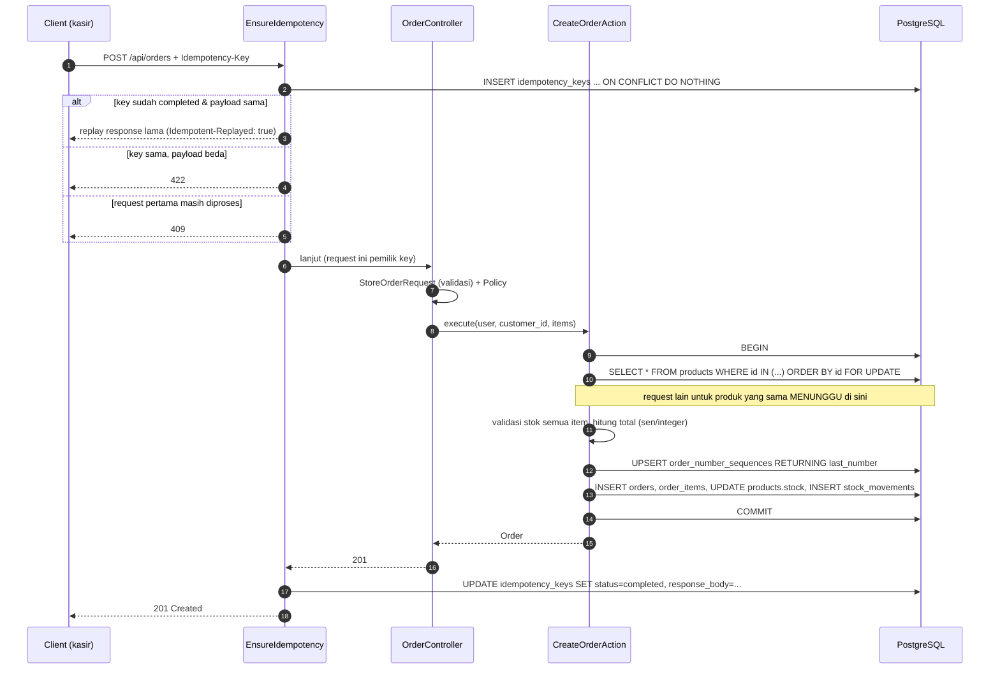

# ARCHITECTURE

## 1. Diagram arsitektur



### Alur kritis: membuat order



## 2. Struktur layer & alasannya

```
HTTP layer      routes/api.php → Middleware → FormRequest → Controller → Resource
                (format, validasi, otorisasi, mapping JSON — tidak ada logika bisnis)
                        │
Application     app/Actions/*Action.php        satu class = satu use case, pemilik DB transaction
                        │
Domain/Service  app/Domain/Order/*             aturan bisnis murni (state machine, kalkulasi)
                app/Services/*                 StockService (lock + ledger), IdempotencyService,
                                               OrderNumberGenerator, ReportService, DashboardService
                        │
Persistence     app/Models (Eloquent) + migrations (constraint & index)
```

| Layer | Contoh | Tanggung jawab | Kenapa |
|---|---|---|---|
| Controller | `OrderController::store` | ambil input tervalidasi → panggil Action → bungkus Resource | Tipis, mudah dibaca, mudah diganti (mis. CLI/queue) |
| FormRequest | `StoreOrderRequest`, `StockAdjustmentRequest::authorize()` | validasi & otorisasi **sebelum** controller jalan | Kasir yang tidak berhak dapat 403, bukan 422 |
| Policy | `OrderPolicy`, `ProductPolicy`, Gate `view-reports` | RBAC di backend | Menyembunyikan tombol di UI tidak cukup |
| Action | `CreateOrderAction`, `TransitionOrderAction` | orkestrasi use case + `DB::transaction` | Batas transaksi jelas di satu tempat; bisa dipakai ulang (seeder memakai Action yang sama) |
| Domain | `OrderStateMachine`, `OrderTotalCalculator` | aturan bisnis murni tanpa DB/HTTP | Unit test cepat, tidak butuh framework |
| Service | `StockService` | satu-satunya pintu mengubah `products.stock` + tulis ledger | Mustahil ada perubahan stok yang tidak tercatat |
| Exception | `DomainException` → `ApiExceptionRenderer` | error bisnis membawa HTTP status sendiri (409/422/403) | Format error konsisten di semua endpoint |

**Kenapa bukan Repository pattern / DDD penuh?** Eloquent sudah merupakan abstraksi persistence; menambah
repository interface untuk aplikasi seukuran ini hanya menambah indireksi tanpa manfaat nyata. Saya memilih
"Action + Service + Domain murni" yang cukup untuk memisahkan aturan bisnis dari HTTP, tetap idiomatik Laravel.

### Perubahan desain database dari acuan soal

| Perubahan | Alasan |
|---|---|
| Tabel `order_status_histories` | Timeline status di halaman detail & audit siapa mengubah apa |
| Tabel `idempotency_keys` | ADR-002 |
| Tabel `order_number_sequences` | Nomor order harian bebas race condition (UPSERT atomik) |
| Kolom `orders.invoice_sent_at` | Penanda idempotensi job email invoice |
| Tabel `notifications` (bawaan Laravel) | Notifikasi stok menipis untuk admin |
| UNIQUE `(order_id, product_id)` di `order_items` | Satu produk satu baris per order (duplikat digabung/ditolak) |
| CHECK `stock >= 0`, `price > 0`, `quantity > 0`, `total >= 0` | Lapisan pertahanan terakhir di database |
| `gender` = `male`/`female` | Nilai enum netral bahasa; label "Pria/Wanita" di UI |

### Index yang ditambahkan

| Index | Query yang dilayani |
|---|---|
| `orders (status, paid_at)` | Laporan sales & top products: `WHERE status IN (...) AND paid_at BETWEEN ...` |
| `orders (order_date)`, `orders (customer_id, order_date)` | List order dengan filter tanggal / customer |
| `order_items (order_id)`, `order_items (product_id)` | JOIN laporan & load item order (PostgreSQL **tidak** otomatis membuat index untuk FK) |
| `stock_movements (product_id, created_at)` | Riwayat ledger per produk |
| `stock_movements (reference_type, reference_id)` | Cari pergerakan stok milik suatu order |
| GIN trigram `products.product_name`, `customers.customer_name` | Search `ILIKE '%kata%'` (B-tree tidak bisa) |
| UNIQUE `idempotency_keys (user_id, key)` | Klaim key atomik |
| `idempotency_keys (expires_at)` | Pruning harian |

---

## 3. Architecture Decision Records

### ADR-001 — Strategi konsistensi stok: pessimistic lock `SELECT … FOR UPDATE` berurutan

**Konteks.** Banyak kasir bisa memesan produk yang sama bersamaan. Pola naif "baca stok → cek → update" mengalami
*lost update*: dua transaksi membaca stok 5, keduanya menulis 4. Hal ini terbukti di test: tanpa lock,
20 dari 20 order paralel untuk stok 5 **sukses semua**. CHECK `stock >= 0` tidak menolong karena nilai yang ditulis
tetap positif.

**Opsi yang dipertimbangkan.**

| Opsi | Kelebihan | Kekurangan |
|---|---|---|
| A. Pessimistic lock `SELECT … FOR UPDATE` | Sederhana, benar, validasi semua item dengan data yang terkunci, pesan error per item akurat | Request untuk produk yang sama antre (serial) |
| B. Conditional atomic update `UPDATE … SET stock = stock - ? WHERE id = ? AND stock >= ?` | Sangat cepat, tanpa lock eksplisit | Sulit memberi pesan "tersisa 3, diminta 5" untuk semua item sekaligus; tetap perlu urutan untuk multi-item |
| C. Optimistic locking (kolom `version` + retry) | Tidak menahan lock | Pada produk "panas" banyak retry gagal; logika retry menambah kompleksitas |
| D. Redis lock / antrean per produk | Skala tinggi | Dua sumber kebenaran, kompleks, risiko lock tidak dilepas |

**Keputusan.** Opsi A di `StockService::lockProducts()`:
1. Semua perubahan stok terjadi dalam `DB::transaction`.
2. Produk dikunci dengan `lockForUpdate()` dan **diurutkan berdasarkan `id`** (`ORDER BY id`). PostgreSQL
   mengambil row lock sesuai urutan hasil sort, sehingga semua transaksi mengunci dengan urutan yang sama →
   **tidak ada deadlock** pada order multi-item (dibuktikan test: 16 order paralel `[A,B]` vs `[B,A]`).
3. Validasi stok dilakukan **setelah** lock, sehingga data yang dicek pasti tidak berubah sampai commit.
4. Urutan lock global konsisten: `orders` (saat transisi) → `products` (urut id) → `order_number_sequences`.
5. CHECK constraint `stock >= 0` sebagai jaring pengaman terakhir.

Pembatalan aman terhadap request ganda: baris **order** dikunci (`FOR UPDATE`) lalu status dibaca ulang di
dalam transaksi; request kedua menunggu, lalu melihat `CANCELLED` → state machine menolak (409), stok tidak
dikembalikan dua kali (test: 10 cancel paralel → 1 sukses, 9 × 409).

**Konsekuensi.** Throughput per produk menjadi serial (satu transaksi per produk pada satu waktu). Transaksi
dibuat pendek (tanpa I/O eksternal: email/invoice dikirim lewat queue *after commit*) sehingga lock hanya
ditahan beberapa milidetik. Untuk volume jauh lebih besar lihat bagian 4.

### ADR-002 — Desain idempotency untuk `POST /api/orders`

**Konteks.** Jaringan kasir bisa putus setelah request terkirim; client me-retry → berisiko order ganda.

**Opsi.** (A) Tabel PostgreSQL; (B) Redis `SET NX` dengan TTL; (C) unique constraint pada payload hash di tabel orders.

**Keputusan.** Opsi A — tabel `idempotency_keys`, middleware `EnsureIdempotency`, service `IdempotencyService`.
- Header `Idempotency-Key` **wajib** dan harus UUID (422 jika tidak).
- Scope key: `(user_id, key)` — key yang sama dari user lain tidak bentrok.
- **Klaim atomik**: `INSERT … ON CONFLICT DO NOTHING`. UNIQUE constraint menjamin hanya satu request menang
  walaupun datang di milidetik yang sama (test: 8 request paralel dengan key sama → 1 order).
- Hash request = SHA-256 dari method + path + body JSON yang key-nya diurutkan (urutan field tidak berpengaruh).
- Perilaku:

| Kondisi | Response |
|---|---|
| Key baru | Diproses normal; jika 2xx, status code + body disimpan |
| Key sama + payload sama + sudah selesai | Replay response tersimpan + header `Idempotent-Replayed: true` |
| Key sama + payload **berbeda** | **422** — kesalahan ada di request client (memakai ulang key untuk maksud lain), bukan konflik state server. Sejalan dengan draft IETF *Idempotency-Key HTTP header* |
| Request pertama **masih diproses** | **409** — konflik sementara; client boleh retry sebentar lagi |
| Request pertama gagal (4xx/5xx) | Key **dilepas** (dihapus) supaya client bisa retry dengan key yang sama setelah memperbaiki kondisi (mis. stok ditambah) |
| Proses pertama crash (lock > 60 detik) | Request berikutnya mengambil alih key secara atomik |

- **Masa berlaku key: 24 jam**, lalu dihapus oleh scheduler (`model:prune`, tiap jam).

**Kenapa bukan Redis?** Respons tersimpan harus tahan restart dan sebaiknya berada di database yang sama
dengan order agar mudah diaudit. Redis lebih cepat, tetapi kehilangan data saat eviction/restart bisa membuat
order ganda — yang justru ingin dicegah.

**Konsekuensi.** Satu INSERT + satu UPDATE tambahan per order (murah). Klaim key berada di luar transaksi order
(autocommit) supaya request paralel bisa melihatnya; konsekuensinya ada jendela kecil di mana order sudah commit
tetapi response belum tersimpan — jika proses mati di titik itu, retry setelah 60 detik akan memproses ulang.
Mitigasi lanjutan: simpan `idempotency_key` di tabel orders dengan UNIQUE constraint.

### ADR-003 — Strategi autentikasi: Sanctum personal access token dengan expiry

**Konteks.** Track B mensyaratkan Sanctum API token dengan expiry dan revoke saat logout. Frontend adalah SPA terpisah.

**Opsi.** (A) Sanctum personal access token (Bearer); (B) Sanctum SPA cookie (session + CSRF);
(C) JWT access + refresh token (seperti Track A).

**Keputusan.** Opsi A.
- Login membuat token dengan `expires_at = now + SANCTUM_EXPIRATION` (default 480 menit) dan ability = role.
- Logout menghapus token saat ini (`currentAccessToken()->delete()`) → langsung tidak valid.
- `sanctum.guard = []` → murni token, tidak bergantung session/cookie.
- Rate limit login 5×/menit per email+IP; pesan error sama untuk email & password salah.
- Token expired dibersihkan scheduler (`sanctum:prune-expired`).
- Frontend: interceptor axios menangkap 401 → hapus token, bersihkan cache, redirect ke login (logout paksa).

**Konsekuensi.** Token tersimpan di `localStorage` sehingga rentan dicuri jika ada XSS. Mitigasi saat ini:
Vue meng-escape output secara default, tidak memakai `v-html`, header keamanan di nginx. Jika aplikasi berada di
domain yang sama/subdomain, Sanctum SPA cookie (HttpOnly + CSRF) lebih aman. Tidak ada refresh token —
user login ulang setiap 8 jam (cukup untuk satu shift kasir).

### ADR-004 — State machine order di layer domain

Tabel transisi di `OrderStateMachine::TRANSITIONS` adalah **satu-satunya** sumber aturan
"dari status X ke Y oleh role apa". Dipakai oleh: `TransitionOrderAction` (validasi, 409/403),
`OrderPolicy` (403 sebelum menyentuh DB), dan `OrderResource.available_actions` (tombol di frontend).
Menambah status baru = menambah satu baris di tabel + kolom timestamp, tanpa menyentuh controller.

### ADR-005 — Uang dihitung dalam sen (integer)

`decimal` dari DB dibaca sebagai string, dikonversi ke sen (int), dihitung, lalu dikembalikan sebagai string
2 desimal (`OrderTotalCalculator`). Menghindari error floating point (`0.1 + 0.2`). Frontend memakai cara yang sama
untuk total real-time, tetapi total final selalu dari server.

### ADR-006 — Efek samping asinkron dikirim *after commit*

`SendOrderPaidNotification` dan `NotifyLowStock` di-dispatch dengan `->afterCommit()` sehingga job tidak pernah
berjalan untuk data yang di-rollback. Job email idempotent: `WithoutOverlapping(orderId)` + cek `invoice_sent_at`.
Retry 5× dengan backoff 10/30/60/120 detik; setelah habis masuk `failed_jobs` dan `failed()` menulis log error.
Catatan jujur: pengiriman email bersifat *at-least-once* — jika worker mati tepat setelah SMTP sukses tetapi
sebelum `invoice_sent_at` tersimpan, retry akan mengirim ulang. *Exactly-once* tidak mungkin dengan SMTP;
mitigasinya outbox table + Message-ID deterministik.

### ADR-007 — Cache dashboard: cache-aside + invalidasi eksplisit

`DashboardService::summary()` memakai `Cache::remember` (Redis, TTL 5 menit). Setiap aksi yang mengubah angka
(order dibuat, transisi status, stock adjustment, CRUD produk/pelanggan) memanggil `forget()`.
TTL tetap ada sebagai jaring pengaman (mis. angka "hari ini" berganti saat tengah malam). Semua angka order
dihitung dengan **satu query agregat** memakai `COUNT(*) FILTER (WHERE …)`.

---

## 4. Jika harus melayani 50.000 order/hari dari banyak cabang

50.000 order/hari ≈ 0,6 order/detik rata-rata; dengan jam sibuk (mis. 5× rata-rata) ≈ 3 order/detik.
Angka ini **masih sanggup** ditangani desain sekarang di satu PostgreSQL. Yang berubah adalah *hotspot*,
ketersediaan, dan operasional multi-cabang:

| Area | Sekarang | Perubahan |
|---|---|---|
| Stok per cabang | Satu kolom `products.stock` | Tabel `branch_stocks (branch_id, product_id, stock)`; lock per (cabang, produk) → kontensi terbagi per cabang. Ledger diberi `branch_id` |
| Hot product | Lock baris serial | Untuk produk sangat panas: conditional atomic update (`UPDATE … WHERE stock >= ?`) atau stok dibagi beberapa "bucket" baris; reservasi ber-TTL untuk order PENDING yang tidak dibayar |
| Nomor order | Counter harian global (satu baris panas) | Counter per cabang + prefix cabang `INV-JKT01-20261021-0001`, atau sequence PostgreSQL per cabang |
| Database | Satu instance | Primary + read replica untuk laporan/list; PgBouncer untuk connection pooling; partisi `orders`/`stock_movements` per bulan |
| Laporan | Agregasi on-the-fly | Tabel ringkasan harian (materialized view / rollup job) per cabang; query laporan membaca rollup |
| API | 1 container | Horizontal scaling di belakang load balancer (API sudah stateless); Laravel Octane untuk latensi |
| Queue | 1 worker | Beberapa worker + Horizon, antrean terpisah (`emails`, `notifications`, `reports`) dengan prioritas |
| Idempotency | Tabel tunggal | Tetap di PostgreSQL + `idempotency_key` UNIQUE di tabel orders; pruning terjadwal |
| Integrasi | Sinkron di satu DB | Outbox pattern + event (`OrderPaid`) ke message broker untuk sistem lain (akuntansi, gudang) |
| Offline cabang | Tidak didukung | POS cabang dengan antrean lokal + sinkronisasi memakai Idempotency-Key (sudah siap) |
| Observability | Log JSON + request_id | Tracing OpenTelemetry, metrics Prometheus (latency, lock wait, queue depth), alert, dashboard Grafana |
| Keamanan | Token 8 jam | SSO/Device binding per kasir, audit log aksi sensitif, secret manager |

## 5. Decisions

Jawaban lengkap 4 pertanyaan wajib (stok minus, struktur folder, bug yang ditemui, bagian yang masih lemah)
ada di [DECISIONS.md](DECISIONS.md).

## 6. Rencana berikutnya

1. Simpan `idempotency_key` di `orders` (UNIQUE) untuk menutup jendela crash di ADR-002.
2. Audit log (`audit_logs`) untuk hapus produk, stock adjustment, cancel order — via model event / Action.
3. Codegen type frontend dari `docs/openapi.json` (`openapi-typescript`) agar kontrak FE/BE tervalidasi di CI.
4. E2E Playwright (login → buat order → pay) dijalankan di CI melawan `docker compose`.
5. Export laporan CSV sebagai background job + notifikasi saat siap diunduh.
6. Endpoint `/metrics` (Prometheus) dan tracing OpenTelemetry.
